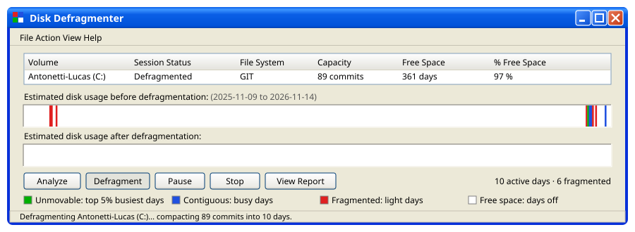

  

### 📁 Documents

 

### 🛠️ Control Panel

  
  
  
  
  
  
  
  
  
  
  
  
  
  
  <!-- add more: logo names are on https://simpleicons.org -->

### 💽 Disk Defragmenter

### 🌐 My Network

  
  

